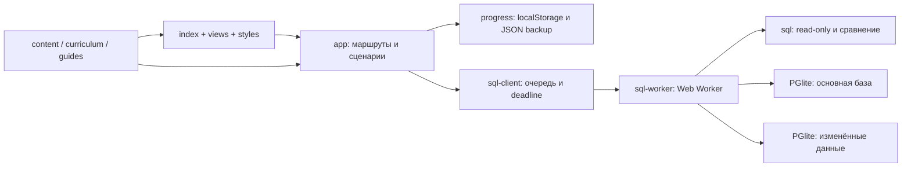

# Архитектура SQL4LEARN

Решение от 12.11.2026: глубокая модернизация существующей ES-module архитектуры.

## Почему сохраняем основу

| Критерий | Модернизация | Полная замена |
| --- | --- | --- |
| Трудоёмкость | Локальные границы runtime/content/delivery уже определены | Повторная реализация всех существующих сценариев и миграций |
| Риск | Сохраняется проверенный контент и пользовательские сохранения | Высок риск потерять практику и совместимость сохранений |
| Тестируемость | Node SQL suite + браузер уже существуют | Инфраструктуру придётся воспроизводить |
| Сопровождение | Требуется постепенное дробление app/views | Новый стек сам по себе не улучшит проверку SQL или методику |
| Развитие | Worker и структурированный контент добавляются отдельно | Оправдано позже только конкретными системными ограничениями |

Сроки не оценены в человеко-днях без декомпозиции и команды. Рабочая основа качественна для статической SQL-практики; заявленной полной академией её не считаем.

## Реализованные слои

В UI нет PostgreSQL-объектов. Клиент передаёт SQL и контракт задачи через postMessage. Все операции сериализуются. На deadline Worker прекращается, базы создаются заново; зависший SQL не повторяется. Черновики/достижения находятся вне Worker. Результат свыше лимита отклоняется, а не выдаётся за полный правильный ответ. Детали и ограничения — SQL_RUNTIME.md.

## Учебная модель

- Модуль: стабильный id, цель, список уроков; урок: теория, example SQL, question, несколько tasks.
- Guide: цель, requires, прогноз, pitfall/check; walkthrough: предметные шаги и мини-таблицы.
- Задача: id, постановка, SQL эталона, ordered и принадлежность уроку/модулю. В самостоятельном проекте дополнительно контракт отчёта и схема.
- База: SQL seed, документированная схема, SQL alternate. Сейчас три бизнес-домена, всего 17 таблиц.
- Прогресс v1/curriculumVersion2: чтение, SQL-зачёты, вопросы, legacyMastered, черновики, заметки, расписание review с отдельными level/round.

Это фактическая модель. Отдельные сущности курсов/компетенций/типизированных grading contracts пока частично представлены соглашениями JS и docs; универсальной CMS нет. Добавление урока не требует изменения UI-компонента, но нуждается в guide/walkthrough/SQL fixtures и проверке зависимостей.

## Хостинг и экономика

GitHub Pages подходит текущему статическому продукту: нет пользовательского SQL на сервере, нет серверных секретов и межпользовательской БД. Сборка `npm ci && npm run build`, deploy только dist. Версия PostgreSQL runtime зафиксирована и размещается локально вместе с WASM; внешние шрифты имеют системный fallback. release.json связывает публикацию с SHA.

Сервер не добавляется только для регистрации или декоративного прогресса. Для лабораторий транзакций, блокировок и EXPLAIN будущая серверная среда должна создавать отдельный disposable PostgreSQL на сессию, с непривилегированной ролью, квотами CPU/memory/disk/time, запретом outbound и никаких production credentials. Это план, не существующая функция. Точная стоимость требует нагрузочных замеров и числа одновременных учеников.

## Проверки

Node: содержание, зависимости/идентификаторы, корректность SQL на двух наборах, сопоставление результатов, прогресс/миграция, SLA и ротация, timeout RPC/cursor. Chromium: полный учебный путь + runtime timeout/recovery + доступность axe. CI сначала проверяет собранный artifact, затем публикует и проверяет SHA и живую версию.

Следующие технические границы: schema для контента, typed comparator с допусками NUMERIC, visible storage errors/attempt log, поиск, разделение view-модулей и самостоятельные серверные PostgreSQL labs. Переезд текущего SELECT-тренажёра на сервер без причины не планируется.
